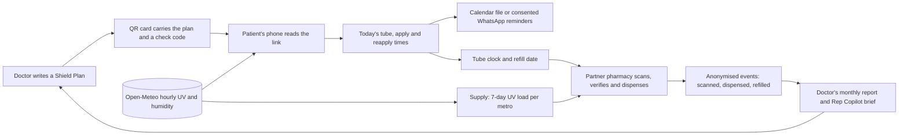

# ShieldCast: the prescription that reads the sky

**Live site:** https://sabyapro123.github.io/photostable-shieldcast/
**Watch the film:** https://sabyapro123.github.io/photostable-shieldcast/film.html (two minutes, with captions)
**See the research:** https://sabyapro123.github.io/photostable-shieldcast/research.html (modelled survey, live patient survey, competitor map)
**Try a patient plan:** open the site and choose *Open Ananya's plan*, or scan the QR code on any card issued in the Doctor view.

ShieldCast turns a dermatologist's Photostable prescription into a daily, weather-aware protection plan. The QR code on the Rx card opens a page that reads the live UV forecast for the patient's city. It tells her which Photostable tube to use today, the exact times to apply and reapply, how many days her tube has left and which partner pharmacy has the refill. The same forecast tells Sun's supply team which cities to restock before a high-UV week.

There is no app to install, no login and no patient data on a server, because the prescription lives inside the link.

> Concept prototype by team **ChampsGrid** (Prerana Sahu, Sabyasachi Samal and Bhupender Pratap Singh), IIM Mumbai, for **Sun PRISM Season 2**. It is not a Sun Pharma service and gives no medical advice.

## What is new in version 2

The idea is now "right tube, right time, right through the year."

- **Course Rx.** The doctor writes a course of 8, 12 or 24 weeks, and the plan turns it into a number of tubes.
- **Season Switch.** The texture can change when the weather spell changes, at a refill and only if the doctor allows it. Melasma always stays on Pro+.
- **Protected Days.** One number, shared only with consent, tells the clinic how many days the patient followed the plan.
- **SunDot.** A UV-reactive dot on the cap is shown as a pack concept for a pilot test.
- **E-prescription line.** One button copies the plan for the clinic's e-prescription software.
- **Research page.** A modelled survey of patients, pharmacists and dermatologists, kept clearly apart from the live patient survey.

## Why this idea

| Problem we found | What ShieldCast does | Evidence |
| --- | --- | --- |
| Doctors default to one variant because the roles overlap, and three of the four labels carry the same SPF 55. | The Shield Map gives each variant one job and a backup. Course Rx adds a course length, and Season Switch lets the texture change at a refill when the weather spell changes. | PRISM-ISF Delphi consensus, J Cosmet Dermatol, 2025 |
| Patients do not know when to reapply, so they stop. | The plan reads the hourly UV forecast and gives exact times, only when UV is 3 or more and the patient is outdoors. | WHO UV index guidance |
| Reminders with local weather work. | Calendar reminders now, and consented WhatsApp messages in the pilot, both built from the forecast. | Daily use rose from 30% to 56% in a randomised trial of weather-plus-reminder texts (Armstrong et al., Arch Dermatol, 2009) |
| Melasma relapses without visible-light protection. | Pro+ stays on every day for melasma, with a midday top-up. | Visible-light protection improved MASI by 15% more than UV-only (Castanedo-Cazares et al., 2014) |
| The prescription is lost at the pharmacy counter. | The pharmacist scans the card, checks its code and can only offer the doctor's backup. | Euromonitor: pharmacies grew slower due to limited education and low visibility |
| Stock runs out in the wrong cities at the wrong time. | A 7-day UV load per metro flags where to top up partner pharmacies. | A hypothesis to calibrate in the pilot |
| The sale still happens at the counter. | The pharmacy view and the Restock agent work at the partner pharmacy. | Statista Market Insights: offline channels hold 93.6% of India's sun protection revenue in 2026 |
| Patients need answers between visits. | The Patient Companion answers in plain words and hands clinical questions to a pharmacist. | About 800 million WhatsApp users in India in 2025 (Statista) |

## How everything connects



## What is in the site

| View | What you can do |
| --- | --- |
| **Home** | See today's live peak UV for eight metros and the seven hand-offs in the loop. |
| **Doctor** | Build a Shield Plan, preview today's schedule for the patient's city, and issue a printable Rx card with a QR code. You can also copy the link or share it on WhatsApp. |
| **Patient** | Open the plan from the QR code to see which tube to use today, the hourly UV chart, exact times with tick boxes, a 7-day outlook, a calendar file of reminders, the tube clock, refill reservation, separate consents and a routine override. |
| **Pharmacy** | Scan a card with the phone camera or paste its link, verify the check code, dispense the exact tube or the backup, see the shelf and the week's restock signal, and approve a reorder. |
| **Supply** | See the 7-day UV outlook for eight metros, ranked by UV load, with a suggested top-up and product mix. |
| **Agents** | Run the four agents and watch every thought, tool call, guardrail and hand-off. Approve the drafts they produce, and see the care-desk queue, the WhatsApp outbox and the draft orders fill up. |
| **How it works** | Read the architecture, costs, privacy design, roll-out gates and sources. |

## The Agent Desk

ShieldCast runs on four agents that share one set of tools. Each agent may call only the tools it is given, and every guardrail is enforced inside the tools, so it holds whether the agent runs on rules or on Claude.

| Agent | Who it serves | Tools it may call | What a person must approve |
| --- | --- | --- | --- |
| Prescribing Copilot | The dermatologist | `get_uv_forecast`, `build_shield_plan` | The doctor approves the draft plan before any card is issued. |
| Patient Companion | The patient, on her phone | `todays_protection`, `set_day_routine`, `tube_status`, `find_stock`, `reserve_refill`, `log_feedback_for_doctor`, `escalate_to_care_desk` | The patient confirms a refill hold. A pharmacist handles every clinical question. |
| Pharmacy Restock agent | Partner pharmacies | `restock_signal` | The pharmacist approves each draft order. |
| Orchestrator | The 6 am morning run | `get_uv_forecast`, `queue_whatsapp`, `restock_signal`, and hand-offs to the Restock agent | Messages go only to patients who opted in. |

**Guardrails.** The Companion cannot change the prescribed variant, names no other brand and hands any reaction, eye contact, pregnancy or child to a human pharmacist before any model is called. The Copilot never adds a humid or dry rule for melasma and logs a portfolio gap when no variant fits. The Orchestrator's message tool refuses any patient without reminder consent.

**Two engines.** The rules engine is the default: it is free, works offline and gives the same answer every time, which suits a judged demo and an audited pilot. Choosing **Claude** in the Agent Desk lets the Copilot and the Companion plan their own tool calls through the Anthropic Messages API, using the same tool schemas (`claudeTools()` in `js/agents.js`). The key stays in the browser, or a pilot can deploy the Cloudflare Worker in [`worker/`](worker/README.md) so no key reaches any browser.

## Architecture

- **Static front end.** Plain HTML, CSS and ES modules, hosted on GitHub Pages. There is no build step.
- **Plan in the link.** The Shield Plan is compact JSON, base64url-encoded into `?rx=`, with a 6-character check code. In production Sun would sign the plan (for example as a JWS) so pharmacies can trust it offline.
- **Plan engine.** `js/plan.js` holds pure functions for variant choice, the schedule, the tube clock, the restock signal and calendar export, tested in `tests/plan.test.mjs`.
- **Agents.** `js/agents.js` holds the tools, the four agents, the guardrails and the optional Claude loop, tested in `tests/agents.test.mjs`.
- **Live data.** `js/forecast.js` calls the Open-Meteo forecast API for hourly `uv_index`, `relative_humidity_2m` and `temperature_2m`. If the API cannot be reached, the page shows a clearly labelled sample forecast.
- **Scanning.** The browser's `BarcodeDetector` is used where available, with [jsQR](https://github.com/cozmo/jsQR) as the fallback.
- **State.** Tick boxes, the tube date, consents and reservations stay in the patient's own browser (`localStorage`).

The production path, the data model and the costs are in [docs/ARCHITECTURE.md](docs/ARCHITECTURE.md).

## Run it locally

```bash
python3 -m http.server 8000
# open http://localhost:8000
node --test tests/plan.test.mjs tests/agents.test.mjs
```

## Data and licences

- Weather data: [Open-Meteo](https://open-meteo.com/), CC BY 4.0. It is free for non-commercial use, and a pilot would use a commercial licence or IMD data.
- QR generation: [qrcodejs](https://github.com/davidshimjs/qrcodejs), MIT. QR scanning fallback: jsQR, Apache-2.0.
- Product facts are from November 2026 Indian pharmacy listings. Stores and stock are examples.
- Code: MIT (see LICENSE). Product names belong to their owners.
